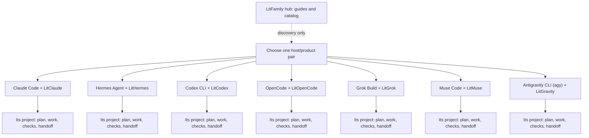

<p align="center"><picture><source media="(prefers-reduced-motion: reduce)" srcset="assets/brand/exports/litfamily-cover-motion-still.webp" /></picture></p>
<p align="center"><a href="assets/brand/exports/litfamily-cover-motion-still.webp">View the still frame</a> · <a href="assets/brand/exports/litfamily-cover-film.mp4">Watch the 11-second film with sound</a></p>

# LitFamily

**Keep the work lit.**

LitFamily is seven open-source add-ons, one for each of seven AI coding agents, that help the agent plan a task, check its own work, and leave a note in your project so the next session can carry on.

<p align="center">


</p>

**[Install](#install) · [What you can make](#what-you-can-make) · [See it work](#see-it-work) · [Quick start](#quick-start) · [Key features](#key-features) · [Commands and hooks](#commands-and-hooks) · [Links](#links) · [한국어](README_ko-KR.md)**

The workflow is half of it. The other half is skills that make finished things: drawings, decks, reports, pages and films. Each picture below came out of LitClaude from one short typed request, and [What you can make](#what-you-can-make) shows the rest, each with the request that made it.

<table>
<tr><td width="50%" valign="top"><br /><sub>lit-schematic · P&amp;ID</sub></td><td width="50%" valign="top"><br /><sub>lit-schematic · isometric cutaway</sub></td></tr>
<tr><td width="50%" valign="top"><br /><sub>lit-diagram-drawer · architecture</sub></td><td width="50%" valign="top"><br /><sub>frontend-ui-ux · dashboard</sub></td></tr>
</table>

## Install

Each product is its own npm package, written for one agent. Find the agent you already use, then run its line in a terminal. One product is all you need; none of them depends on another.

### Pick your agent

| Your agent | Product | Install command |
|---|---|---|
| Claude Code | [LitClaude](https://github.com/wjgoarxiv/litclaude) | `npm exec --yes --package @litfamily/litclaude@1.0.39 -- litclaude install --yes` |
| Hermes Agent | [LitHermes](https://github.com/wjgoarxiv/lithermes) | `npx --yes --package @litfamily/lithermes@1.0.29 -- lithermes install --yes --no-style` |
| Codex CLI | [LitCodex](https://github.com/wjgoarxiv/litcodex) | `npm exec --yes --package @litfamily/litcodex@1.0.30 -- litcodex install` |
| OpenCode | [LitOpenCode](https://github.com/wjgoarxiv/litopencode) | `npm exec --package @litfamily/litopencode@1.0.31 -- litopencode install` |
| Grok Build | [LitGrok](https://github.com/wjgoarxiv/litgrok) | `npm exec --yes --package @litfamily/litgrok@1.0.26 -- litgrok install` |
| Muse Code | [LitMuse](https://github.com/wjgoarxiv/litmuse) | `npx @litfamily/litmuse@0.1.1 install` |
| Antigravity CLI (`agy`) | [LitGravity](https://github.com/wjgoarxiv/litgravity) | `npx @litfamily/litgravity@0.1.1 install` |

You need Node.js with npm and the agent itself. LitCodex asks for Node.js 22 or later and LitHermes for 18 or later. Each product's README explains what its installer changes, the questions it may ask, how to preview the changes first, and how to remove it again.

LitMuse and LitGravity require Node.js 20 or later. LitMuse is an independent community project, not affiliated with Meta.

### Let a coding agent install it

If you would rather hand the install to the coding agent you already use, paste this prompt into it. The agent works out which LitFamily product fits, then follows that product's own install steps, which are written for agents too.

```text
Install the LitFamily product that matches the coding agent I use.
1. Ask me which agent I want it for if you can't tell: Claude Code, Codex CLI, OpenCode, Hermes Agent, Grok Build, Muse Code or Antigravity CLI (agy). The matching products are LitClaude, LitCodex, LitOpenCode, LitHermes, LitGrok, LitMuse and LitGravity.
2. Open that product's README on GitHub (github.com/wjgoarxiv/<product name in lower case>) and follow the install prompt it gives for coding agents. Use only the official npm package @litfamily/<product name in lower case>.
3. Before you change anything, show me your plan and wait for my yes.
4. When it is installed, run the product's own check (doctor or status), tell me what was written and where, and tell me how to restart my agent so it loads.
```

If you use Claude Code, you can also install LitClaude from this hub's plugin marketplace, right inside Claude Code:

```text
/plugin marketplace add wjgoarxiv/litfamily
/plugin install litclaude@litfamily
```

Choose one of the two routes for LitClaude and stay with it, so the same plugin is never switched on twice. The marketplace gives you the plugin itself; the optional status line and host settings come from the npm installer. [More about the marketplace](docs/marketplaces.md).

### After you install

- **Claude Code** — [LitClaude](https://github.com/wjgoarxiv/litclaude): Start a project conversation with `lit`.
- **Hermes Agent** — [LitHermes](https://github.com/wjgoarxiv/lithermes): Restart the Hermes CLI or gateway, check that the plugin and its skills loaded, then start with `lit`.
- **Codex CLI** — [LitCodex](https://github.com/wjgoarxiv/litcodex): Start a project conversation with `lit`.
- **OpenCode** — [LitOpenCode](https://github.com/wjgoarxiv/litopencode): Restart OpenCode, press **Tab**, pick the `lit-loop` agent, and describe the task.
- **Grok Build** — [LitGrok](https://github.com/wjgoarxiv/litgrok): Run the installer inside the project you want to try (the files land in its `.grok/` folder), review hook trust, then invoke `/litwork`.
- **Muse Code** — [LitMuse](https://github.com/wjgoarxiv/litmuse): Approve its hooks and agents, run its `doctor`, then start a Muse project conversation with `lit`.
- **Antigravity CLI (`agy`)** — [LitGravity](https://github.com/wjgoarxiv/litgravity): Run its `doctor`, then start with `lit` in your project. Execute an approved plan with `lit start plans/<slug>.md`.

> [!NOTE]
> **Released on npm.** All seven products are published under the `@litfamily` npm scope, including the LitMuse and LitGravity 0.1.0 first releases. The versions and release commits are listed in [release status](docs/release-status.md).

The same commands appear on each npm page: [`@litfamily/litclaude`](https://www.npmjs.com/package/@litfamily/litclaude) · [`@litfamily/lithermes`](https://www.npmjs.com/package/@litfamily/lithermes) · [`@litfamily/litcodex`](https://www.npmjs.com/package/@litfamily/litcodex) · [`@litfamily/litopencode`](https://www.npmjs.com/package/@litfamily/litopencode) · [`@litfamily/litgrok`](https://www.npmjs.com/package/@litfamily/litgrok) · [`@litfamily/litmuse`](https://www.npmjs.com/package/@litfamily/litmuse) · [`@litfamily/litgravity`](https://www.npmjs.com/package/@litfamily/litgravity). The hub has no universal installer. Host configuration, login, interactive choices, and removal differ by product.

## What you can make

Every picture in this section is a real output of LitClaude 1.0.39, the Claude Code product. Where a prompt sits under a picture, that request produced it in a Claude Code session (long ones are cut short with …); where none does, the skill's own engine made it from the example the skill ships with. None of them is a mock-up.

What you can reproduce depends on your product today. Most of these skills ship in all seven products, and each port runs them in its own harness. Three skills and the fuller default look are in LitClaude 1.0.39 only, and the other six products are porting them now:

| What | Where it ships today |
|---|---|
| `lit-diagram-drawer`, `lit-scientific-visualization`, `lit-pptx`, `lit-docx`, `frontend-ui-ux`, `lit-typographic-motion`, `readme-studio` | All seven products |
| `lit-schematic` (P&IDs, apparatus figures, cutaways), `lit-adhd`, `lit-hijack` | LitClaude 1.0.39; the other six are porting them |
| The fuller default look these pictures show (dense layouts, several accent colours, a signature detail) | LitClaude 1.0.39; the other six are porting it |
| The LIT card with thread rows | LitClaude 1.0.39, in Claude Code's status line |

### Draw it

Equipment, systems and data, each drawn by the skill that knows its rules: ISA-5.1 tags and a title block on a P&ID, material colours on a cutaway, numbered flows on an architecture, error bands on a figure.

<table>
<tr><td width="50%" valign="top"><br /><b>lit-schematic</b> · P&amp;ID on one A3 sheet<br /><code>lit draw a detailed P&amp;ID of a distillation column overhead section on one A3 sheet: shell-and-tube overhead condenser, reflux drum, duty and standby reflux pumps, LIC to FIC cascade …</code></td><td width="50%" valign="top"><br /><b>lit-schematic</b> · isometric cutaway<br /><code>lit-schematic 교반식 재킷 회분 반응기(jacketed stirred batch reactor)의 등각 단면 사시도를 그려줘</code></td></tr>
<tr><td width="50%" valign="top"><br /><b>lit-diagram-drawer</b> · system architecture<br /><code>lit-diagram-drawer 음식 배달 플랫폼의 시스템 아키텍처 다이어그램을 그려줘</code></td><td width="50%" valign="top"><br /><b>lit-scientific-visualization</b> · two-panel journal figure<br /><code>/litclaude:lit-scientific-visualization 현재 폴더의 data.csv(세 온도에서 측정한 CO2 흡착 등온선, 반복 2회)를 논문용 그림으로 만들어줘</code></td></tr>
<tr><td width="50%" valign="top"><br /><b>lit-schematic</b> · apparatus figure<br /><code>lit 레이저 광학 벤치 실험 장치를 저널 double column 그림 한 장으로 그려줘 …</code></td><td width="50%" valign="top"><br /><b>lit-schematic</b> · cutaway as a loop<br /><code>lit … 오토클레이브 컷어웨이를 짧은 루프 모션 영상으로 만들어줘: 분해된 부품이 조립되고, 임펠러가 돌고, 냉각수가 코일을 따라 흐르게</code></td></tr>
</table>

### Present it

Name a style, or let lit-pptx choose one from thirteen. Every deck has native, editable charts and KPI rows, Pretendard embedded, and passed a gate for overflow, contrast and empty slides.

<table>
<tr><td width="50%" valign="top"><br /><b>lit-pptx</b> · newsroom, 10 slides<br /><code>lit 우리 구 주민에게 보여줄 2026년 대중교통 이용 데이터 브리핑 발표자료 10장, 뉴스룸 스타일로</code></td><td width="50%" valign="top"><br /><b>lit-pptx</b> · neo-brutalism pitch<br /><code>lit 신규 서비스 투자 피칭 덱 10장, 네오 브루탈리즘 스타일로. 글자와 숫자는 크고 굵게</code></td></tr>
<tr><td width="50%" valign="top"><br /><b>lit-pptx</b> · one deck, 13 tonalities<br /><sub>The same sample deck rendered by the engine in all thirteen tonalities, from paper and newsroom to riso, night and ledger.</sub></td></tr>
</table>

### Write it

lit-docx writes a Word file you can keep editing: a cover, key figures with their basis, tables with right-aligned numbers and a decision box, then renders the pages and looks at them before it hands the file over.

<table>
<tr><td width="50%" valign="top"><br /><b>lit-docx</b> · Korean report, Report tonality<br /><sub>Built from the skill's bundled example <code>references/examples/01-report-ko.md</code> by its own converter; the layout gate passed.</sub></td><td width="50%" valign="top"><br /><b>lit-docx</b> · English report and a proposal<br /><sub>Two more bundled examples: <code>07-report-en.md</code> (Report) and <code>04-proposal-ko.md</code> (Proposal).</sub></td></tr>
</table>

### Build it

frontend-ui-ux locks a house style before it writes markup, builds the page, then opens it at several widths and reviews its own screenshots. readme-studio does the same for a project cover.

<table>
<tr><td width="50%" valign="top"><br /><b>frontend-ui-ux</b> · operations dashboard<br /><code>Build the operations dashboard for Coldline, a regional delivery company that runs a fleet of refrigerated trucks. …</code></td><td width="50%" valign="top"><br /><b>frontend-ui-ux</b> · landing page, neo-brutalism<br /><code>Build the marketing landing page for Ledgerline … Make it neo-brutalism: loud, friendly, bold outlines and hard shadows.</code></td></tr>
<tr><td width="50%" valign="top"><br /><b>frontend-ui-ux</b> · landing page, computational brutalism<br /><code>Build the marketing landing page for Ledgerline … Make it retro-futurist computational brutalism: raw, mechanical, like an instrument or a spec sheet.</code></td><td width="50%" valign="top"><br /><b>readme-studio</b> · README cover<br /><sub>The skill's HyperFrames cover template with every letter outlined by its own type tool, for a sample project.</sub></td></tr>
</table>

### Film it

lit-typographic-motion writes a treatment first, then renders the film frame by frame with a sound bed and checks flashes, legibility and the loop seam. The prompt below names no tool and never asks for a dense look; the layering, colour and sound came from the defaults.

<table>
<tr><td width="50%" valign="top"><br /><b>lit-typographic-motion</b> · 13-second hero film, poster<br /><code>lit LitClaude 히어로 영상 13초짜리 만들어줘. LIT 불꽃 키가 주인공으로, 프롬프트 → 계획 → 작업 → 리뷰 → 완료로 lit-loop가 돌아가는 세계를 고퀄리티 3D로 보여줘.</code></td><td width="50%" valign="top"><br /><b>lit-typographic-motion</b> · frames from the same film<br /><sub>Twelve frames of that film, from the dark opening to the LitClaude title.</sub></td></tr>
</table>

### Keep track of it

When two workflows and three helpers run at once, the LIT card draws them as threads under the prompt. Type <code>lit adhd</code> after a scattered day and you get one brief: what you asked, what got done, what is paused and the next step. <code>go</code> then picks up the single open plan.

<table>
<tr><td width="50%" valign="top"><br /><b>LIT card</b> · thread rows<br /><sub>Drawn by the card's own renderer: lit-loop paused at GREEN, start-work running under it, three lanes in parallel.</sub></td><td width="50%" valign="top"><br /><b>lit-adhd</b> · the brief<br /><code>lit adhd</code></td></tr>
<tr><td width="50%" valign="top"><br /><b>lit-adhd</b> · go resumes the plan<br /><code>go</code></td></tr>
</table>

### Learn from others

Point <code>lit hijack</code> at an article, a post, a PDF or a repository and name your own skill. It records where each source came from and what its licence allows, writes a spec in its own words, has it built in isolation, runs the old and new skill on the same held-out prompt, and ends with a port report.

<table>
<tr><td width="50%" valign="top"><br /><b>lit-hijack</b> · port report<br /><code>lit hijack https://x.com/… into .claude/skills/promo-brief</code></td><td width="50%" valign="top"><br /><b>lit-hijack</b> · old skill against new<br /><sub>The proof: two runs of the old skill beside two of the new one on the same prompt. The old briefs invent product features; the new ones ask instead.</sub></td></tr>
</table>

## See it work

<!-- demo-gif -->
<p align="center"><picture><source media="(prefers-color-scheme: dark)" srcset="https://raw.githubusercontent.com/wjgoarxiv/litcodex/f7107e147185af19cb020de6a1051aa9fbfdd8c4/docs/assets/screens/screen-lit-ignited-dark.webp" /></picture></p>

This is LitCodex in a Codex CLI session. Each request that begins with `lit`, `handoff` or `lit recap` is answered with the LIT mark and the name of the workflow that took it, so you can tell at a glance which mode is running. The other products greet you in their own host's way, and each product README shows its own screens.

## Quick start

Start in an empty project after completing the product's activation checks. Try a small task that needs no external data or dependency installation:

```text
lit Build a to-do list in a single HTML file without external dependencies.
Implement add, complete, and delete. Check the behavior and leave the next step.
```

In **Grok Build**, use its explicit skill route instead:

```text
/litwork Build a to-do list in a single HTML file without external dependencies.
Implement add, complete, and delete. Check the behavior and leave the next step.
```

Open the result yourself and try adding, completing, and deleting an item. Ask the agent what it actually checked and what remains unchecked. If a browser is unavailable, a generated file alone does not prove that the interface works. A logo or activation message tells you the workflow has started; whether the task is finished is something you still check.

## Key features

A spark has been placed in your hands. Give it a project to live in.

A bug you want fixed. A screen you want built. A project you want to finish.

Starting takes a line. After a long conversation or a session change, carrying on takes more: finding what you decided, what you checked, and what is still left to do.

**LIT gives that work a place to stay.** Goals, plans, checked results, and next steps remain with the project so the next session has something to pick up. Choose the product for the harness you already use; the seven products are independent.

### A shared workflow

```text
Plan → Build → Verify → Hand off
```

| Step | Leave something useful |
|---|---|
| **Plan** | The result you want, its constraints, and how to tell it works |
| **Build** | The smallest useful change in the current project |
| **Verify** | Checks that ran, their results, and anything still unverified |
| **Hand off** | Decisions, relevant file paths, and the next action |

Before ending the session, ask it to save that handoff. In the next session, point the agent to the saved record and ask it to read it before continuing. Record paths and resume tools are specific to each product; follow its guide.

**Keep the work lit** means leaving work that can be continued. It does not mean that a closed session keeps running, or that a new session automatically knows everything.

## Commands and hooks

Choose the one product that matches your host. Append `lit` to a prompt where that host supports the bare route; Grok Build uses `/litwork`. Ask for `handoff` to carry the checked result into another session. Use `lit-plan` before work, `/start-work` only for an approved plan, and `/review-work` to inspect the result. `litresearch` is available only in products that document it.

| You need | Start here |
| --- | --- |
| Begin the work loop | `lit` (or the host's documented explicit route) |
| Carry the next step | `handoff` / `/lit-handoff` |
| Plan, execute, review | `lit-plan` → `/start-work` → `/review-work` |
| Source-backed research | `litresearch` where the selected product ships it |

For Antigravity CLI, execute an approved plan with `lit start plans/<slug>.md`.

## Troubleshooting

Keep your existing configuration and read the selected product's migration guide before replacing an installation. If an ownership check refuses a destination, retain the error and existing files; do not delete state to force a retry.

Use only the diagnostic and removal commands that product documents. **There is no family-wide `doctor` or uninstall command.** In particular, LitGrok has no `doctor` command, and LitOpenCode removal follows its manual guide. Check what happens to customized files before removing anything.

For a problem, follow [Support](SUPPORT.md): include the product and host version, redacted command, expected behavior, and observed output. Installation, skill discovery, and task completion are separate observations. Publishing, destructive actions, and changes to access still require your project's authorization.

## Links

### Documentation

Choose a task before choosing a skill. The [complete skill catalog](docs/skills.md) lets you explore planning, execution, review, research, visualization, English and Korean prose editing, Word and PowerPoint files, diagrams, short films and READMEs, with the requirements for each host. Every product now includes `lit-humanizer`, `lit-docx`, `lit-pptx`, `lit-diagram-drawer`, `lit-typographic-motion` and `readme-studio`. Before they build, `lit-pptx` and `lit-docx` work out who will read the file and choose a look for that reader, from eight for decks and six for documents, and the reply names two others that would also fit. LitClaude 1.0.39 adds three skills of its own: `lit-adhd` (or `lit-rewind`) reads your recent sessions and tells you where each one stands and what to do next, `lit-hijack` brings a technique you read about into one of your own skills, and `lit-schematic` draws P&IDs, apparatus figures and cutaways. A matching skill name does not make it portable between hosts.

The seven product READMEs above explain the actual installation paths, entry points, permissions, optional tools, and limitations. This hub helps you find them; it does not add a shared runtime.

### Skills and native marketplaces

The [complete skill catalog](docs/skills.md) records every native entry and supporting skill document, with host-specific compatibility. Install the matching product for its full native workflow. The root `skills/` directory provides independently verified direct exports and currently contains the complete Grok Build `lit-humanizer` skill tree, checked for file hashes and reference closure. Other host variants remain traceable in the catalog by product, source path and commit.

[Claude marketplace and Codex pointer](docs/marketplaces.md) · [Brand artwork and licenses](assets/brand/README.md) · [Contributing](CONTRIBUTING.md) · [Security](SECURITY.md) · [Support](SUPPORT.md) · [Code of conduct](CODE_OF_CONDUCT.md) · [Privacy](PRIVACY.md) · [License](LICENSE)

### LITFAMILY

<details>
<summary>Additional workflows and editorial visuals</summary>

## How the family fits together

The hub helps you find a product; it does not run your work. Choose one host/product pair. Its plans, working files, checks, and handoffs belong to that project, with record paths defined by that product.



These are seven independent alternatives to install. Products do not share a runtime or depend on one another. The diagram summarizes the workflow; commands, permissions, and record formats remain specific to each host.

### Product editorial cues

<table>
<tr><td><a href="https://github.com/wjgoarxiv/litclaude"></a><br /><strong>LitClaude</strong><br />on npm</td>
<td><a href="https://github.com/wjgoarxiv/lithermes"></a><br /><strong>LitHermes</strong><br />on npm</td></tr>
<tr><td><a href="https://github.com/wjgoarxiv/litcodex"></a><br /><strong>LitCodex</strong><br />on npm</td>
<td><a href="https://github.com/wjgoarxiv/litopencode"></a><br /><strong>LitOpenCode</strong><br />on npm</td></tr>
<tr><td><a href="https://github.com/wjgoarxiv/litgrok"></a><br /><strong>LitGrok</strong><br />on npm</td>
<td><a href="https://github.com/wjgoarxiv/litmuse"></a><br /><strong>LitMuse</strong><br />on npm</td></tr>
<tr><td><a href="https://github.com/wjgoarxiv/litgravity"></a><br /><strong>LitGravity</strong><br />on npm</td></tr>
</table>

[](assets/brand/exports/ignition-film.mp4)

## Practical routes and editorial cues

Use these routes only through the product and host you selected. `lit` starts the work loop where the host supports the bare route; `handoff` records the checked result and next step; `lit-plan` lays out an approved path; `/start-work` executes that approved plan; `/review-work` inspects the result; and `litresearch` is available only when the selected product documents it. Grok Build documents `/litwork` as its explicit entry. Each route has a product-specific host limit: this hub only explains the choices and does not execute them, install a runtime, or make unsupported routes available.

<table>
<tr><td><strong>LitClaude</strong><br /></td>
<td><strong>LitHermes</strong><br /></td></tr>
<tr><td><strong>LitCodex</strong><br /></td>
<td><strong>LitOpenCode</strong><br /></td></tr>
<tr><td><strong>LitGrok</strong><br /></td>
<td><strong>LitMuse</strong><br /></td></tr>
<tr><td><strong>LitGravity</strong><br /></td></tr>
</table>

## LITFAMILY


Claude, Hermes, Codex, OpenCode, Grok, Muse, and Gravity, pictured as seven armored machines. Choose the product for the tool you use. This is an editorial illustration of the family, not a screenshot of the software.

## See the mark

[](assets/brand/exports/ignition-film.mp4)

[Play the 10-second film](assets/brand/exports/ignition-film.mp4) · [Animated GIF](assets/brand/exports/ignition-demo.gif) · [Static poster](assets/brand/exports/ignition-poster.png) · [Brand gallery](assets/brand/gallery.html)

An authored motion graphic illustrates the LitFamily workflow. It is a brand demonstration, not a recording of installation or host execution. The animated GIF and the 10-second film are linked above.

<p align="center"></p>

<details>
<summary>Copy ASCII logo</summary>

```text
          ▄▖  ▄█▄
▗▄▄▖    ▄██▌  ▜█▛
▐██▌  ▄████████████▜▛
▐██▌ ▐█▀▀▀▀▀▀▀▀▀▀▀▀▘
▐██▌   ▄█▌█████████▌
▐██▌ ▄██▛▘  ▗▄▄  ▗
▐██▌▐█▛▘    ▐██  ▝▀
▐██▌▝       ▐██
▐██████▘    ▐██
▝▀▀▀▀▀      ▝▀▀
```

</details>

<p align="center">
<a href="docs/skills.md"> Docs</a> &nbsp; <a href="assets/brand/exports/ignition-film.mp4"> Ignition</a> &nbsp; <a href="LICENSE"> MIT</a>
</p>

<details>
<summary>Ignition cover</summary>


</details>


</details>
