<p align="center"><picture><source media="(prefers-reduced-motion: reduce)" srcset="assets/brand/exports/litfamily-cover-motion-still.webp" />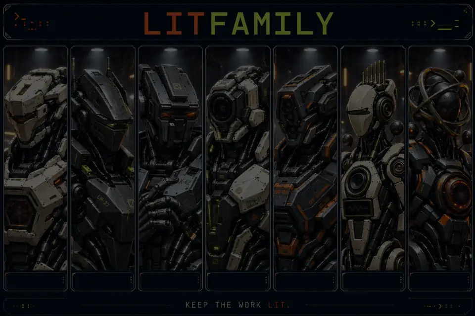</picture></p>
<p align="center"><a href="assets/brand/exports/litfamily-cover-motion-still.webp">정지 프레임 보기</a> · <a href="assets/brand/exports/litfamily-cover-film.mp4">소리와 함께 11초 영상 보기</a></p>

# LitFamily

**Keep the work lit.**

LitFamily는 AI 코딩 에이전트 일곱 종류에 하나씩 맞춰 만든 오픈소스 확장입니다. 에이전트가 작업을 계획하고, 결과를 스스로 확인하고, 다음 세션이 이어받을 수 있도록 프로젝트에 기록을 남기게 도와줍니다.

<p align="center">


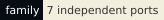
</p>

**[설치](#설치) · [실제 화면](#실제-화면) · [빠른 시작](#빠른-시작) · [주요 기능](#주요-기능) · [명령과 훅](#명령과-훅) · [링크](#링크) · [English](README.md)**

## 설치

제품마다 npm 패키지가 따로 있고, 각각 에이전트 하나를 위해 만들어졌습니다. 지금 쓰는 에이전트를 찾아 그 줄의 명령을 터미널에 붙여 넣으면 됩니다. 하나만 설치하면 되고, 다른 제품이 함께 필요하지는 않습니다.

### 에이전트 고르기

| 쓰는 에이전트 | 제품 | 설치 명령 |
|---|---|---|
| Claude Code | [LitClaude](https://github.com/wjgoarxiv/litclaude) | `npm exec --yes --package @litfamily/litclaude@1.0.37 -- litclaude install --yes` |
| Hermes Agent | [LitHermes](https://github.com/wjgoarxiv/lithermes) | `npx --yes --package @litfamily/lithermes@1.0.28 -- lithermes install --yes --no-style` |
| Codex CLI | [LitCodex](https://github.com/wjgoarxiv/litcodex) | `npm exec --yes --package @litfamily/litcodex@1.0.29 -- litcodex install` |
| OpenCode | [LitOpenCode](https://github.com/wjgoarxiv/litopencode) | `npm exec --package @litfamily/litopencode@1.0.30 -- litopencode install` |
| Grok Build | [LitGrok](https://github.com/wjgoarxiv/litgrok) | `npm exec --yes --package @litfamily/litgrok@1.0.25 -- litgrok install` |
| Muse Code | [LitMuse](https://github.com/wjgoarxiv/litmuse) | `npx @litfamily/litmuse@0.1.0 install` |
| Antigravity CLI (`agy`) | [LitGravity](https://github.com/wjgoarxiv/litgravity) | `npx @litfamily/litgravity@0.1.0 install` |

npm이 함께 설치된 Node.js와 해당 에이전트가 있어야 합니다. LitCodex는 Node.js 22 이상, LitHermes는 18 이상이 필요합니다. 설치 프로그램이 무엇을 바꾸는지, 설치 중에 무엇을 묻는지, 바뀔 내용을 미리 보는 방법과 제거하는 방법은 각 제품 README에 정리되어 있습니다.

LitMuse와 LitGravity는 Node.js 20 이상이 필요합니다. LitMuse는 Meta와 제휴하지 않은 독립 커뮤니티 프로젝트입니다.

### 코딩 에이전트에게 설치 맡기기

쓰고 있는 코딩 에이전트에게 설치를 맡기고 싶다면 아래 프롬프트를 붙여 넣으세요. 에이전트가 맞는 LitFamily 제품을 고른 뒤, 그 제품 README에 에이전트용으로 적힌 설치 순서를 그대로 따릅니다.

```text
내가 쓰는 코딩 에이전트에 맞는 LitFamily 제품을 설치해 줘.
1. 어떤 에이전트용인지 모르겠으면 먼저 물어봐. Claude Code, Codex CLI, OpenCode, Hermes Agent, Grok Build, Muse Code, Antigravity CLI(agy) 중 하나야. 각각 맞는 제품은 LitClaude, LitCodex, LitOpenCode, LitHermes, LitGrok, LitMuse, LitGravity야.
2. 그 제품의 GitHub README(github.com/wjgoarxiv/<소문자 제품 이름>)를 열고, 코딩 에이전트용 설치 프롬프트를 따라 해. 공식 npm 패키지 @litfamily/<소문자 제품 이름>만 써.
3. 무엇이든 바꾸기 전에 계획을 먼저 보여 주고 내가 좋다고 할 때까지 기다려.
4. 설치가 끝나면 그 제품의 점검 명령(doctor 또는 status)을 돌리고, 무엇을 어디에 썼는지와 에이전트를 어떻게 다시 시작해야 불러오는지 알려 줘.
```

Claude Code를 쓴다면 Claude Code 안에서 이 허브의 플러그인 마켓플레이스로 LitClaude를 설치할 수도 있습니다.

```text
/plugin marketplace add wjgoarxiv/litfamily
/plugin install litclaude@litfamily
```

LitClaude는 두 경로 가운데 하나만 골라 계속 쓰세요. 같은 플러그인이 두 번 켜지는 일을 막을 수 있습니다. 마켓플레이스로는 플러그인 자체만 설치되고, 선택 사항인 상태 표시줄과 호스트 설정은 npm 설치 프로그램이 맡습니다. 자세한 내용은 [마켓플레이스 안내](docs/marketplaces.md)에 있습니다.

### 설치한 다음에는

- **Claude Code** — [LitClaude](https://github.com/wjgoarxiv/litclaude): 프로젝트 대화에서 `lit`으로 요청.
- **Hermes Agent** — [LitHermes](https://github.com/wjgoarxiv/lithermes): Hermes CLI나 게이트웨이를 다시 시작하고, 플러그인과 스킬이 불러와졌는지 확인한 뒤 `lit`으로 요청.
- **Codex CLI** — [LitCodex](https://github.com/wjgoarxiv/litcodex): 프로젝트 대화에서 `lit`으로 요청.
- **OpenCode** — [LitOpenCode](https://github.com/wjgoarxiv/litopencode): OpenCode를 다시 시작하고 **Tab**을 눌러 `lit-loop` 에이전트를 고른 뒤 작업 요청.
- **Grok Build** — [LitGrok](https://github.com/wjgoarxiv/litgrok): 써볼 프로젝트 안에서 설치 명령을 실행하고(파일은 그 프로젝트의 `.grok/` 폴더에 들어갑니다), 훅 신뢰 설정을 확인한 뒤 `/litwork`로 요청.
- **Muse Code** — [LitMuse](https://github.com/wjgoarxiv/litmuse): 훅과 에이전트 권한을 승인하고 `doctor`로 확인한 뒤, Muse 프로젝트에서 `lit`으로 요청.
- **Antigravity CLI (`agy`)** — [LitGravity](https://github.com/wjgoarxiv/litgravity): `doctor`로 확인한 뒤 프로젝트에서 `lit`으로 요청. 승인한 계획은 `lit start plans/<slug>.md`로 실행.

> [!NOTE]
> **npm에 출시했습니다.** LitMuse·LitGravity 0.1.0 첫 출시를 포함해 일곱 제품 모두 npm `@litfamily` 스코프로 배포되어 있습니다. 버전과 출시 커밋은 [출시 상태](docs/release-status.md)에 있습니다.

같은 명령은 각 npm 페이지에서도 볼 수 있습니다: [`@litfamily/litclaude`](https://www.npmjs.com/package/@litfamily/litclaude) · [`@litfamily/lithermes`](https://www.npmjs.com/package/@litfamily/lithermes) · [`@litfamily/litcodex`](https://www.npmjs.com/package/@litfamily/litcodex) · [`@litfamily/litopencode`](https://www.npmjs.com/package/@litfamily/litopencode) · [`@litfamily/litgrok`](https://www.npmjs.com/package/@litfamily/litgrok) · [`@litfamily/litmuse`](https://www.npmjs.com/package/@litfamily/litmuse) · [`@litfamily/litgravity`](https://www.npmjs.com/package/@litfamily/litgravity). 허브에는 공통 설치기가 없습니다. 호스트 설정, 로그인, 설치 중 선택 항목과 제거 방법은 제품마다 다릅니다.

## 실제 화면

<!-- demo-gif -->
<p align="center"><picture><source media="(prefers-color-scheme: dark)" srcset="https://raw.githubusercontent.com/wjgoarxiv/litcodex/6171a250e22e98eca3e65d368d6be79d5297094f/docs/assets/screens/screen-lit-ignited-dark.webp" /></picture></p>

Codex CLI 세션에서 LitCodex가 동작하는 모습입니다. `lit`, `handoff`, `lit recap`으로 시작한 요청마다 LIT 마크와 그 요청을 맡은 작업 흐름의 이름이 함께 나오기 때문에, 지금 어떤 모드가 돌고 있는지 한눈에 알 수 있습니다. 다른 제품은 각 호스트에 맞는 방식으로 시작을 알리며, 제품별 화면은 각 README에서 볼 수 있습니다.

## 빠른 시작

제품이 활성화됐는지 확인한 뒤, 빈 프로젝트에서 작은 작업 하나를 맡겨보세요. 외부 데이터나 의존성 설치 없이 시작할 수 있는 예제입니다.

```text
lit 외부 의존성 없이 HTML 파일 하나로 할 일 목록을 만들어줘.
추가·완료·삭제 동작을 구현하고, 확인한 내용과 다음 행동을 남겨줘.
```

**Grok Build**에서는 명시적인 스킬 경로로 시작합니다.

```text
/litwork 외부 의존성 없이 HTML 파일 하나로 할 일 목록을 만들어줘.
추가·완료·삭제 동작을 구현하고, 확인한 내용과 다음 행동을 남겨줘.
```

결과물을 직접 열어 항목을 추가하고, 완료하고, 삭제해보세요. 에이전트에게 무엇을 확인했고 무엇이 남았는지 물어보세요. 브라우저를 사용할 수 없다면 파일을 만들었다는 사실만으로 화면과 동작을 확인했다고 할 수 없습니다. 로고나 활성화 문구는 작업 흐름에 들어왔다는 표시입니다. 작업이 끝났는지는 따로 확인해야 합니다.

## 주요 기능

불씨를 건네받았다. 이제, 당신의 작업에 옮길 차례다.

고치고 싶은 버그 하나. 만들고 싶은 화면 하나. 끝내고 싶은 프로젝트 하나.

시작은 짧은 한 줄이면 됩니다. 어려운 건 그다음입니다. 대화가 길어지고 세션이 바뀌면, 어디까지 했는지부터 다시 짚어야 합니다. 어떤 결정을 내렸는지, 무엇을 확인했는지, 다음에는 무엇을 해야 하는지.

**LIT은 그 불씨를 남깁니다.** 목표와 계획, 확인한 결과, 다음에 할 일을 프로젝트에 기록합니다. 다음 세션에서 그 기록을 읽고 작업을 이어갈 수 있도록. 쓰던 도구에 맞는 LIT 하나면 됩니다.

### 공통 작업 흐름

```text
계획하기 → 만들기 → 확인하기 → 다음 작업에 건네기
```

| 단계 | 남길 내용 |
|---|---|
| **계획** | 원하는 결과, 제약, 동작을 확인할 기준 |
| **구현** | 현재 프로젝트에 필요한 변경 |
| **검증** | 실행한 검사, 결과, 아직 확인하지 못한 부분 |
| **인계** | 결정 사항, 관련 파일 경로, 다음 행동 |

세션을 마치기 전에 이 내용을 인수인계 기록으로 남겨달라고 요청하세요. 다음 세션에서는 저장한 기록의 경로를 알려주고, 읽은 뒤 작업을 이어달라고 요청하세요. 기록 위치와 재개 도구는 제품마다 다르므로 해당 안내를 따르세요.

“꺼지지 않는 불”은 프로그램이 끝없이 돌아간다는 뜻이 아닙니다. **세션이 끝나도, 이어갈 작업을 남긴다는 뜻입니다.**

## 명령과 훅

호스트에 맞는 제품 하나를 고르세요. Bare route를 지원하는 호스트에서는 프롬프트 끝에 `lit`을 붙이고, Grok Build에서는 `/litwork`를 사용합니다. `handoff`로 확인한 결과를 다음 세션에 건네고, 작업 전에는 `lit-plan`, 승인한 계획 실행에는 `/start-work`, 결과 검토에는 `/review-work`를 사용하세요. `litresearch`는 해당 제품이 제공할 때만 사용할 수 있습니다.

| 필요한 일 | 시작 경로 |
| --- | --- |
| 작업 루프 시작 | `lit` (또는 제품이 문서화한 명시적 경로) |
| 다음 작업 건네기 | `handoff` / `/lit-handoff` |
| 계획·실행·검토 | `lit-plan` → `/start-work` → `/review-work` |
| 출처 기반 조사 | 선택한 제품이 제공하는 경우 `litresearch` |

Antigravity CLI에서는 승인한 계획을 `lit start plans/<slug>.md`로 실행하세요.

## 문제 해결

기존 설정을 보관하고, 설치를 교체하기 전에 선택한 제품의 이전 안내를 읽으세요. 소유권 검사에서 설치를 거절하면 오류와 기존 파일을 보존하세요. 재시도를 위해 상태 파일부터 지우지 마세요.

각 제품 문서에 나온 진단·제거 방법을 사용하세요. **LitFamily 공통 `doctor`나 제거 명령은 없습니다.** 특히 LitGrok에는 `doctor` 명령이 없고, LitOpenCode는 문서의 수동 제거 절차를 따릅니다. 직접 수정한 파일이 어떻게 처리되는지 먼저 확인하세요.

문제가 생기면 [지원 안내](SUPPORT.md)에 따라 제품과 호스트 버전, 민감한 내용을 가린 명령, 예상한 동작과 실제 출력을 남겨주세요. 설치, 스킬 발견, 작업 완료는 각각 확인합니다. 공개, 파괴적 작업과 접근 권한 변경에는 프로젝트에서 요구하는 승인이 계속 필요합니다.

## 링크

### 문서

스킬 이름보다 하려는 작업을 먼저 고르세요. [전체 스킬 목록](docs/skills.md)에서 계획, 실행, 검토, 조사, 시각화, 영어와 한국어 문장 편집, Word와 PowerPoint 문서, 다이어그램, 짧은 영상, README 작성 기능과 각 호스트의 요구 사항을 살펴볼 수 있습니다. 이제 모든 제품에 `lit-humanizer`, `lit-docx`, `lit-pptx`, `lit-diagram-drawer`, `lit-typographic-motion`, `readme-studio`가 들어 있습니다. `lit-pptx`와 `lit-docx`는 만들기 전에 누가 읽을 파일인지 따져 그 독자에게 맞는 모양을 발표자료 여덟 가지, 문서 여섯 가지 가운데서 고르고, 답에서 함께 어울릴 다른 두 가지도 알려 줍니다. 이름이 같은 스킬이라도 다른 호스트에서 그대로 쓸 수 있는 것은 아닙니다.

실제 설치 위치, 진입점, 권한, 선택 도구와 제약은 위 일곱 제품의 README에 있습니다. 이 허브에서 필요한 제품과 문서를 찾을 수 있습니다. 제품 사이에 공통 실행 환경을 추가하지는 않습니다.

### 스킬과 기본 마켓플레이스

[전체 스킬 목록](docs/skills.md)은 모든 기본 스킬과 보조 문서를 실행 환경별로 분류합니다. 전체 네이티브 워크플로를 쓰려면 사용하는 에이전트에 맞는 제품을 설치하세요. 루트 `skills/`에는 독립 배포를 검토한 스킬을 제공하며, 현재 Grok Build용 `lit-humanizer` 전체 폴더의 파일 해시와 참조 경로를 확인했습니다. 다른 호스트용 변형은 목록의 제품명, 원본 경로와 커밋으로 추적할 수 있습니다.

[Claude 마켓플레이스와 Codex 연결](docs/marketplaces.md) · [브랜드 이미지와 라이선스](assets/brand/README.md) · [기여](CONTRIBUTING.md) · [보안](SECURITY.md) · [지원](SUPPORT.md) · [행동 규칙](CODE_OF_CONDUCT.md) · [개인정보](PRIVACY.md) · [라이선스](LICENSE)

### LITFAMILY

<details>
<summary>추가 제품 안내와 편집 이미지</summary>

## 제품은 어떻게 연결되나요?

허브는 제품과 문서를 찾는 안내서입니다. 작업을 실행하지는 않습니다. 쓰는 호스트에 맞는 제품 하나를 고르면, 그 프로젝트 안에 계획과 작업 파일, 확인 결과, 인수인계 기록을 남깁니다. 기록 위치는 제품별 안내를 따릅니다.

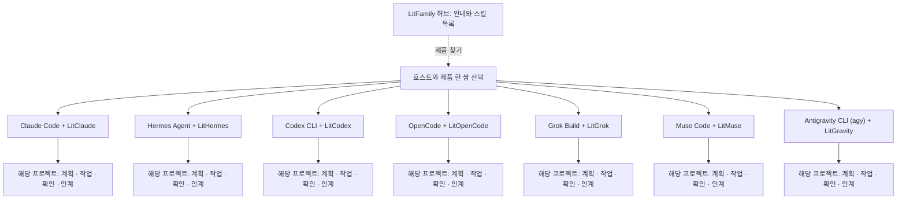

일곱 제품 가운데 쓰는 도구에 맞는 하나를 고르세요. 공통 실행 환경이나 제품 사이의 의존성은 없습니다. 그림은 작업 흐름을 요약한 것이며, 실제 명령·권한·기록 형식은 각 호스트의 방식을 따릅니다.

### 제품 편집 이미지

<table>
<tr><td><a href="https://github.com/wjgoarxiv/litclaude">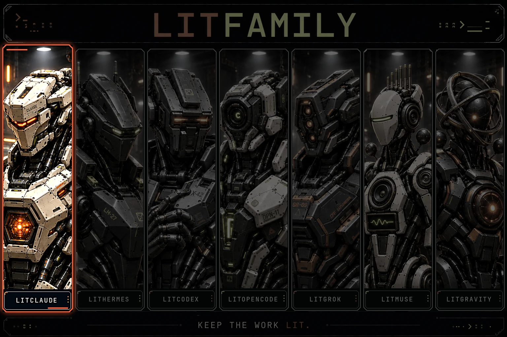</a><br /><strong>LitClaude</strong><br />npm 배포</td>
<td><a href="https://github.com/wjgoarxiv/lithermes">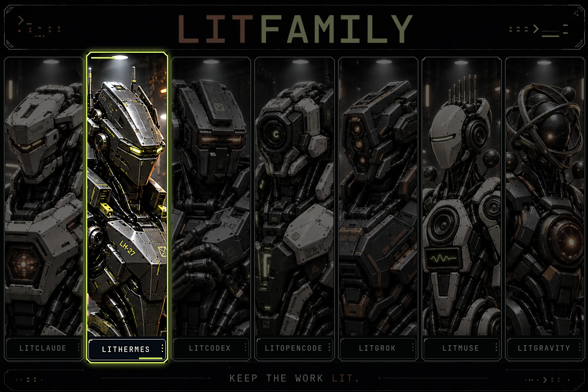</a><br /><strong>LitHermes</strong><br />npm 배포</td></tr>
<tr><td><a href="https://github.com/wjgoarxiv/litcodex">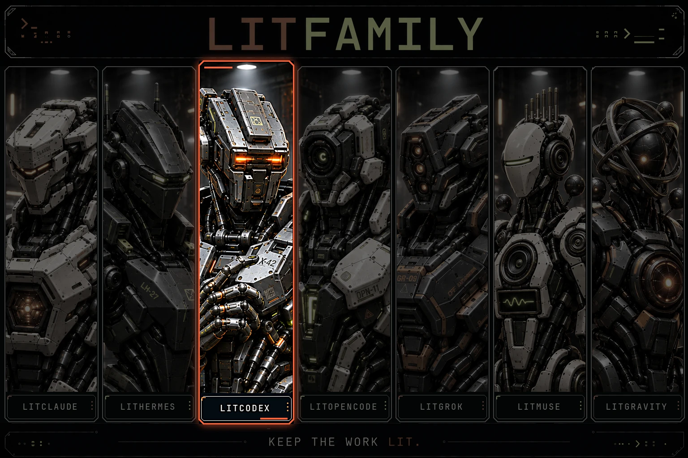</a><br /><strong>LitCodex</strong><br />npm 배포</td>
<td><a href="https://github.com/wjgoarxiv/litopencode">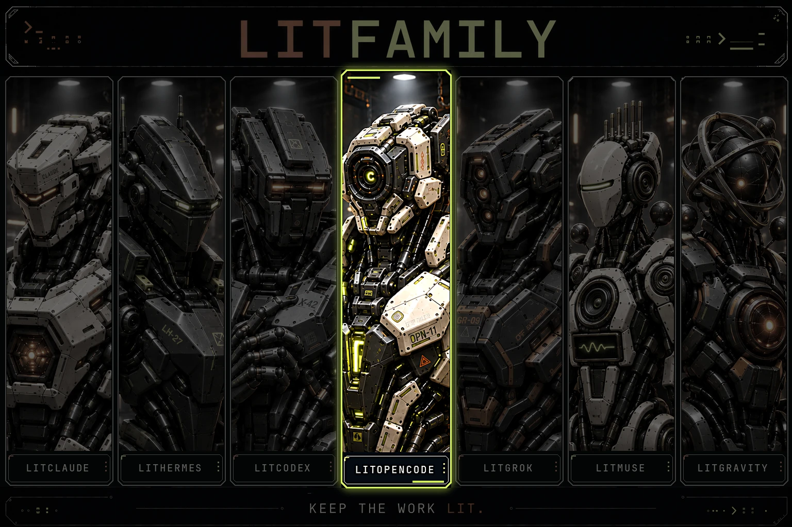</a><br /><strong>LitOpenCode</strong><br />npm 배포</td></tr>
<tr><td><a href="https://github.com/wjgoarxiv/litgrok">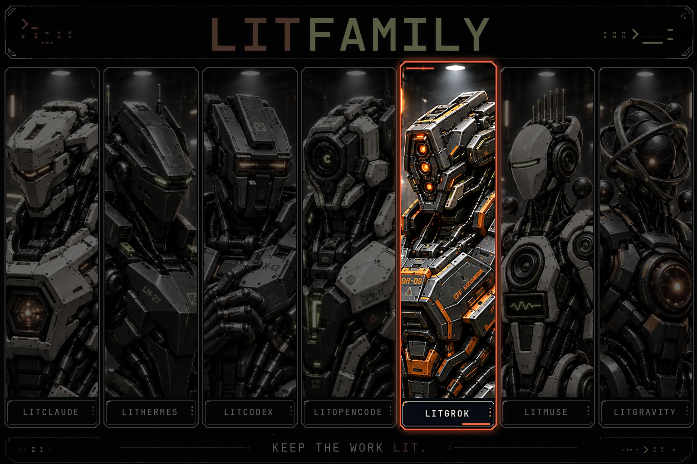</a><br /><strong>LitGrok</strong><br />npm 배포</td>
<td><a href="https://github.com/wjgoarxiv/litmuse">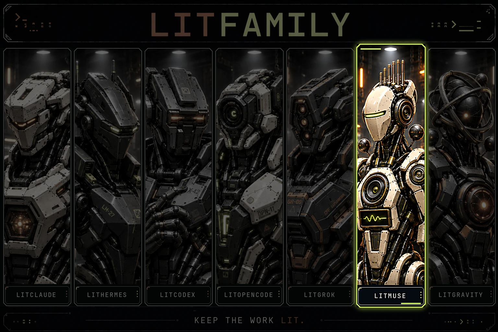</a><br /><strong>LitMuse</strong><br />npm 배포</td></tr>
<tr><td><a href="https://github.com/wjgoarxiv/litgravity"></a><br /><strong>LitGravity</strong><br />npm 배포</td></tr>
</table>

[](assets/brand/exports/ignition-film.mp4)

## 실제 시작 경로와 편집 이미지

선택한 제품과 호스트에서 지원하는 경로만 사용하세요. 호스트가 bare route를 지원하면 `lit`이 작업 루프를 시작하고, `handoff`는 확인한 결과와 다음 단계를 남기며, `lit-plan`은 승인할 작업 경로를 정리하고, `/start-work`는 승인한 계획을 실행하며, `/review-work`는 결과를 살핍니다. `litresearch`는 선택한 제품이 문서로 제공할 때만 사용할 수 있습니다. Grok Build는 명시적 진입점으로 `/litwork`를 문서화합니다. 각 경로에는 제품별 호스트 제약이 있습니다. 이 허브는 선택지를 안내할 뿐 경로를 실행하거나 runtime을 설치하지 않으며, 지원하지 않는 경로를 추가하지 않습니다.

<table>
<tr><td><strong>LitClaude</strong><br /></td>
<td><strong>LitHermes</strong><br /></td></tr>
<tr><td><strong>LitCodex</strong><br /></td>
<td><strong>LitOpenCode</strong><br /></td></tr>
<tr><td><strong>LitGrok</strong><br /></td>
<td><strong>LitMuse</strong><br /></td></tr>
<tr><td><strong>LitGravity</strong><br /></td></tr>
</table>

## LITFAMILY


Claude, Hermes, Codex, OpenCode, Grok, Muse, Gravity를 일곱 아머드 머신으로 그린 편집 일러스트입니다. 쓰는 도구에 맞는 제품을 고르세요. 소프트웨어 화면이 아니라 패밀리를 그린 그림입니다.

## 점화 표시

[](assets/brand/exports/ignition-film.mp4)

[10초 영상 재생](assets/brand/exports/ignition-film.mp4) · [움직이는 GIF](assets/brand/exports/ignition-demo.gif) · [정지 포스터](assets/brand/exports/ignition-poster.png) · [브랜드 갤러리](assets/brand/gallery.html)

LitFamily의 작업 흐름을 표현한 모션 그래픽입니다. 설치나 실제 호스트 실행을 녹화한 영상은 아닙니다. 움직이는 GIF와 10초 영상은 위 링크에서 볼 수 있습니다.

<p align="center">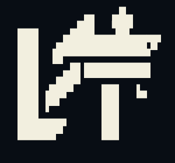</p>

<details>
<summary>Copy ASCII logo</summary>

```text
          ▄▖  ▄█▄
▗▄▄▖    ▄██▌  ▜█▛
▐██▌  ▄████████████▜▛
▐██▌ ▐█▀▀▀▀▀▀▀▀▀▀▀▀▘
▐██▌   ▄█▌█████████▌
▐██▌ ▄██▛▘  ▗▄▄  ▗
▐██▌▐█▛▘    ▐██  ▝▀
▐██▌▝       ▐██
▐██████▘    ▐██
▝▀▀▀▀▀      ▝▀▀
```

</details>

<p align="center">
<a href="docs/skills.md"> Docs</a> &nbsp; <a href="assets/brand/exports/ignition-film.mp4"> Ignition</a> &nbsp; <a href="LICENSE"> MIT</a>
</p>

<details>
<summary>Ignition 커버</summary>

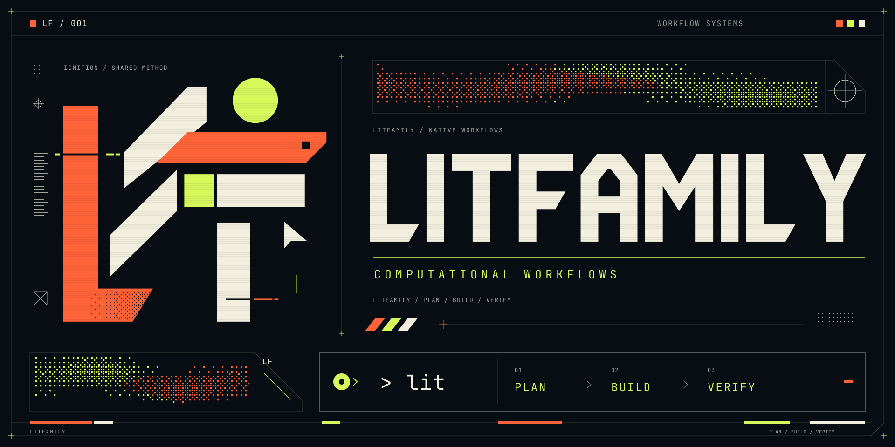

</details>


</details>
